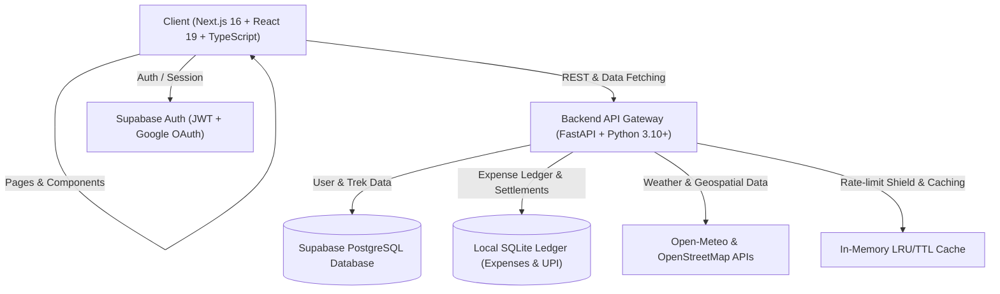

# 🏔️ TrailVerse

<p align="center">
  
</p>

<p align="center">
  <strong>The Next-Generation Platform for Trekkers, Explorers & Mountain Communities</strong>
</p>

<p align="center">
  <a href="#-key-features">Features</a> •
  <a href="#-interactive-trail-maps">Trail Maps</a> •
  <a href="#-ai-safety--risk-scoring">AI Risk Scoring</a> •
  <a href="#-group-trek-expense-splitter">Expense Splitter</a> •
  <a href="#-architecture">Architecture</a> •
  <a href="#-quick-start">Quick Start</a> •
  <a href="#-api-reference">API Docs</a>
</p>

<p align="center">
  
  
  
  
  
  
  
  
</p>

---

## 📖 Overview

**TrailVerse** is an all-in-one outdoor adventure intelligence platform built for solo hikers, mountaineering groups, and expedition leaders. It combines real-time geospatial trail mapping, AI-driven personal trail safety assessments, automated multi-member expense splitting with direct UPI settlements, community group organizing, and mountain weather monitoring.

Whether you're embarking on your first weekend trail or organizing a high-altitude Himalayan expedition, TrailVerse provides the tools to plan, budget, navigate, and connect.

---

## ✨ Key Features

| Feature | Description |
| :--- | :--- |
| 🗺️ **Interactive Geographic Trail Maps** | Explore trails with high-precision Leaflet maps, topographical layers, GPS coordinates, elevation profiles, and instant grid/map toggle. |
| 🧠 **AI-Powered Trail Risk Engine** | Real-time multi-factor safety score (0–100) analyzing terrain gradient, altitude gain, live weather (rain, wind, temperature), and your past hiking experience. |
| 🧭 **Personalized Next-Trek Recommendations** | Dynamic recommendation algorithm that analyzes completed hikes, endurance level, and fitness progression to suggest optimal next summits. |
| 💸 **Group Expense & Permit Splitter** | Multi-category ledger (permits, food, guide, gear, transit), debt-simplification settlement calculations, and integrated UPI QR generation for instant phone checkout. |
| 👥 **Trekker Communities & Groups** | Create expedition groups, coordinate dates, manage member rosters, and organize group discussions. |
| 🏆 **Gamified Leaderboards & Badges** | Climb community rankings, track total elevation conquered, and unlock achievement badges as you summit new trails. |
| ⛅ **Live Weather & Mountain Forecasts** | Real-time meteorological data with in-memory TTL caching to keep altitude forecasts responsive without API rate limits. |
| 🔐 **Zero-Flash Modern Auth** | Seamless authentication powered by Supabase with Google OAuth support, fast client-side session hydration, and zero visual flashing. |

---

## 🗺️ Interactive Trail Maps

The interactive mapping engine ([InteractiveTrailMap.tsx](trailverse/src/components/InteractiveTrailMap.tsx)) allows hikers to inspect terrain details before stepping foot on the trail:

- **Map & Grid Dual-View**: Switch between standard card exploration and interactive full-viewport map.
- **Topographic & OpenStreetMap Layers**: Clear elevation visualization and trail contours.
- **Color-Coded Difficulty Markers**: Easy (Emerald), Moderate (Amber), Difficult (Rose), Extreme (Purple).
- **Interactive Popup Cards**: Preview trail elevation, distance, estimated completion time, and safety scores directly from map pins.

---

## 🧠 AI Safety & Risk Scoring

TrailVerse runs a dedicated safety and risk calculation engine ([main.py](trailverse-api/main.py)):

$$\text{Risk Score} = w_1 \cdot \text{Elevation Gain} + w_2 \cdot \text{Terrain Difficulty} + w_3 \cdot \text{Weather Penalties} - w_4 \cdot \text{Experience Offset}$$

- **Environmental Factors**: Live precipitation probability, ambient temperature, high-altitude wind chill.
- **Personalized Adaptation**: Incorporates user's completed trek history, frequency of hikes, and prior max elevations to calculate tailored individual risk.
- **Safety Advisories**: Highlights warnings such as *"Heavy rainfall forecasted in next 24h"*, *"Technical scrambling required"*, or *"Recommended for experienced trekkers only"*.

---

## 💸 Group Trek & Expense Splitter

Splitting permits, guide fees, vehicle hires, and campsite rations on multi-day treks is often frustrating. TrailVerse includes a built-in group settlement engine ([GroupExpenseSplitter.tsx](trailverse/src/components/GroupExpenseSplitter.tsx)):

- **Multi-Category Tracking**: Tags expenses under *Permits*, *Guide*, *Transportation*, *Food & Rations*, *Gear Rental*, and *Stay*.
- **Debt Simplification**: Automatically balances who paid what and calculates the minimum transactions needed to settle up.
- **Instant UPI QR Payments**: Generates standard UPI payment links and scannable QR codes configured to the organizer's UPI ID for 1-click mobile settlement.

---

## 🏗️ Architecture



### Technology Stack

| Layer | Technologies |
| :--- | :--- |
| **Frontend Framework** | [Next.js 16.2 (App Router)](https://nextjs.org/), [React 19](https://react.dev/), [TypeScript 5](https://www.typescriptlang.org/) |
| **Styling & UI** | [Tailwind CSS 4](https://tailwindcss.com/), [Lucide React](https://lucide.dev/), [Radix UI](https://www.radix-ui.com/) |
| **Mapping & Geospatial** | [Leaflet](https://leafletjs.com/), OpenStreetMap Tiles, Topography Layers |
| **Backend API** | [FastAPI](https://fastapi.tiangolo.com/), [Uvicorn](https://www.uvicorn.org/), [Pydantic v2](https://docs.pydantic.dev/) |
| **Database & Auth** | [Supabase](https://supabase.com/) (PostgreSQL & GoTrue Auth), [SQLite3](https://www.sqlite.org/) |
| **External APIs** | Open-Meteo Weather API, Nominatim, Wikimedia API |
| **Testing** | Playwright E2E browser tests, Pytest backend route & cache test suite |

---

## 📂 Repository Structure

```text
TrailVerse/
├── trailverse/                     # Next.js 16 Frontend Application
│   ├── src/
│   │   ├── app/                    # Next.js App Router
│   │   │   ├── dashboard/          # Trekker Dashboard & Personal Stats
│   │   │   ├── explore/            # Trail Explorer with Map & Filters
│   │   │   ├── features/           # Platform Features Overview
│   │   │   ├── groups/             # Community Groups & Expeditions
│   │   │   │   └── [id]/           # Group Hub & Expense Splitter
│   │   │   └── (auth)/             # Login & Signup Screens
│   │   ├── components/             # Reusable UI Components
│   │   │   ├── InteractiveTrailMap.tsx  # Leaflet Geospatial Map
│   │   │   ├── GroupExpenseSplitter.tsx # UPI Split & Settlement Ledger
│   │   │   ├── TrekExplorer.tsx         # Filterable Trail Directory
│   │   │   ├── Navbar.tsx               # Navigation & Mobile Drawer
│   │   │   └── HeroSection.tsx          # Landing Page Hero
│   │   └── lib/                    # API Clients & Supabase Handlers
│   ├── package.json
│   └── tsconfig.json
│
├── trailverse-api/                 # FastAPI Python Backend
│   ├── main.py                     # Primary Application & Route Handlers
│   ├── expenses.db                 # SQLite Ledger for Expenses & UPI
│   ├── requirements.txt            # Python Dependencies
│   ├── test_cache.py               # Cache Invalidation & Eviction Tests
│   ├── test_risk_scoring.py        # Safety & Risk Engine Unit Tests
│   └── test_sanity_routes.py       # API Route Sanity Tests
│
├── test_browser_all_viewports.py   # Playwright Responsive E2E Tests
├── test_weather_risk_mock.py       # Weather & Fallback Risk Tests
└── README.md
```

---

## 🚀 Quick Start

### Prerequisites

Ensure you have the following installed on your machine:
- **Node.js**: `v18.18.0` or higher (Node 20+ recommended)
- **Python**: `3.10` or higher
- **Git**
- A free **Supabase** account for authentication and database storage

---

### 1. Clone the Repository

```bash
git clone https://github.com/VaradaHumane/TrailVerse.git
cd TrailVerse
```

---

### 2. Backend Setup (`trailverse-api`)

```bash
# Navigate to the backend directory
cd trailverse-api

# Create a virtual environment
python3 -m venv venv
source venv/bin/activate    # On Windows: venv\Scripts\activate

# Install dependencies
pip install -r requirements.txt

# Start the FastAPI server with hot-reloading
uvicorn main:app --reload --port 8000
```

The backend API will be running at **`http://localhost:8000`**.  
Interactive Swagger docs: **`http://localhost:8000/docs`**.

---

### 3. Frontend Setup (`trailverse`)

In a new terminal window:

```bash
# Navigate to the frontend directory
cd trailverse

# Install dependencies
npm install

# Start the Next.js development server
npm run dev
```

The frontend application will be running at **`http://localhost:3000`**.

---

## ⚙️ Environment Variables

### Frontend Configuration (`trailverse/.env.local`)

```env
NEXT_PUBLIC_SUPABASE_URL=https://your-project.supabase.co
NEXT_PUBLIC_SUPABASE_ANON_KEY=your-supabase-anon-key
NEXT_PUBLIC_API_BASE=http://localhost:8000
```

### Backend Configuration (`trailverse-api/.env`)

```env
SUPABASE_URL=https://your-project.supabase.co
SUPABASE_KEY=your-supabase-service-role-key
WIKIMEDIA_CONTACT="https://trailverse.app; admin@trailverse.app"
```

---

## 🔌 API Reference

### Treks & Maps
- `GET /treks` — Retrieve all curated trails with elevation, difficulty, and location.
- `GET /treks/{id}/coordinates` — Get geo-coordinates and waypoints for mapping.
- `GET /treks/{id}/risk?username={user}` — Calculate live risk assessment and safety score.
- `GET /treks/all-with-risk` — Retrieve all trails with real-time safety scores.
- `POST /treks/log` — Log a completed trek to update user stats and achievements.

### Recommendations & Community
- `GET /recommendations/next-trek?username={user}` — Get AI recommended next trail for the user.
- `GET /leaderboard` — Get top community trekkers ranked by altitude and summits.
- `GET /users/{username}` — Fetch user profile, badges, and hiking log.

### Group Trek Expense Splitter & UPI
- `GET /groups/{id}/expenses` — Get all recorded expenses for an expedition group.
- `POST /groups/{id}/expenses` — Record a new group expense (food, permit, guide, etc.).
- `DELETE /groups/{id}/expenses/{expense_id}` — Remove an expense entry.
- `POST /groups/{id}/upi` — Set or update the organizer's UPI ID and recipient name.
- `POST /groups/{id}/settle` — Calculate simplified member balances and generate UPI payment intents.

---

## 🧪 Testing & Verification

TrailVerse includes comprehensive automated testing across the full stack:

### Run Backend Tests

```bash
cd trailverse-api
source venv/bin/activate
pytest test_risk_scoring.py test_cache.py test_sanity_routes.py -v
```

### Run Frontend & End-to-End Browser Tests

```bash
# Verify production build compilation
npm --prefix trailverse run build

# Run Playwright multi-viewport sanity checks
python3 test_browser_all_viewports.py
python3 test_weather_risk_mock.py
```

---

## 🤝 Contributing

Contributions make the open-source community an amazing place to learn, inspire, and create. Any contributions you make are **greatly appreciated**.

1. Fork the Project
2. Create your Feature Branch (`git checkout -b feature/AmazingFeature`)
3. Commit your Changes (`git commit -m 'feat: add some AmazingFeature'`)
4. Push to the Branch (`git push origin feature/AmazingFeature`)
5. Open a Pull Request

---

## 📄 License

Distributed under the **MIT License**. See `LICENSE` for more information.

---

<p align="center">
  Made with ❤️ for trekkers, adventurers, and outdoor communities worldwide.
</p>
